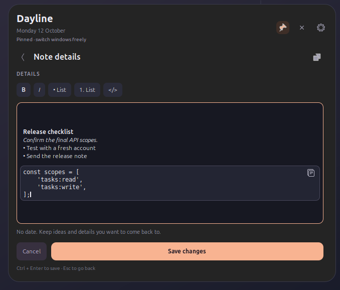
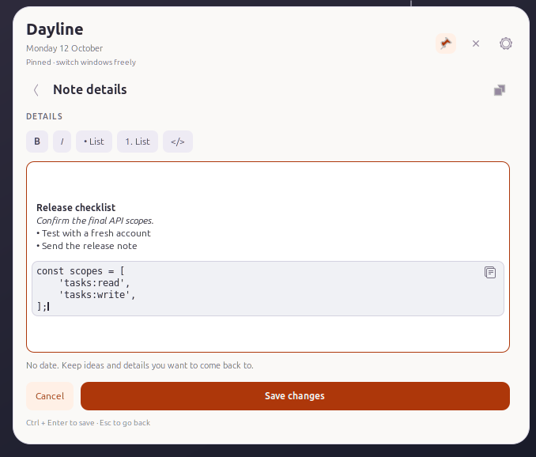
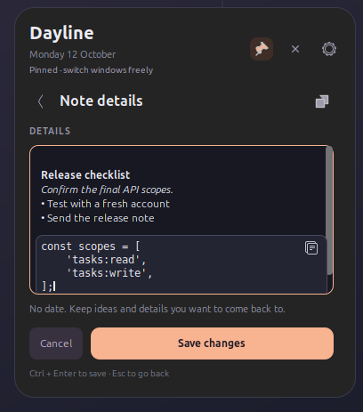
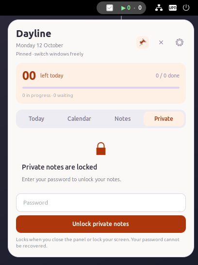
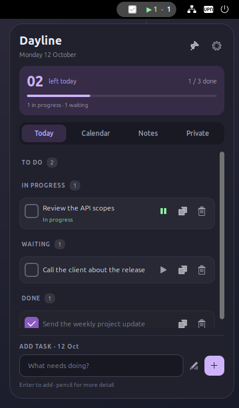
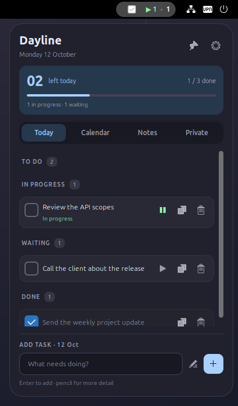
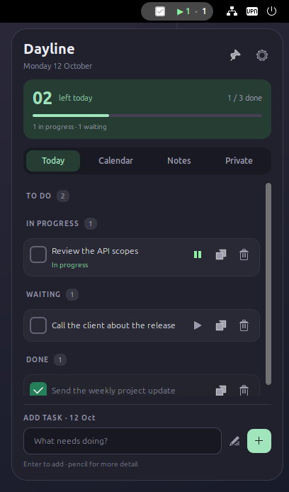
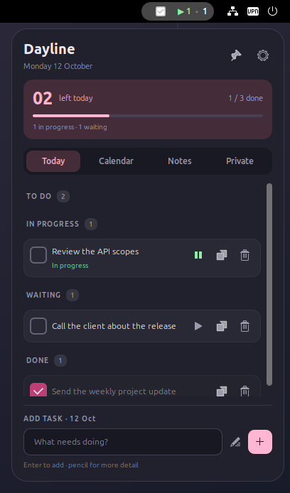
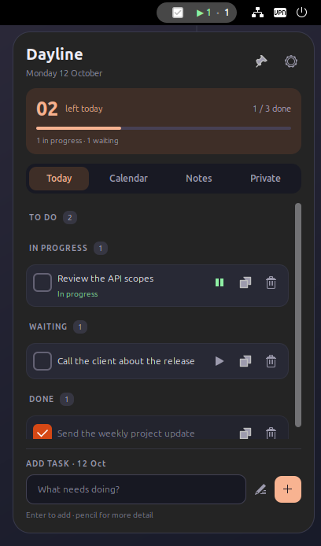

# Dayline

Dayline is a native GNOME Shell extension for tasks and notes. The top bar shows how many tasks are in progress and how many are waiting today. Open the panel to plan a day, write a note, or keep instructions beside the app you are working in.

**Version 0.3.1 · GNOME Shell 50 · Local storage · MIT license**

<table>
  <tr>
    <td align="center"><br><sub>Today, dark appearance</sub></td>
    <td align="center"><br><sub>Today, light appearance</sub></td>
  </tr>
</table>

## Tasks, notes and a calendar

- **Today** shows today's tasks, completed work, daily progress and a separate overdue section. The green top-bar count is for tasks in progress; the other count is for waiting tasks. Completed, overdue and future tasks do not contribute to either count.
- **Calendar** has a Monday-first month grid. Choose a date to see or add its tasks; dots mark days with unfinished work. Overdue tasks keep their original dates until you complete or reschedule them.
- **Notes** holds entries without dates: meeting notes, project details, reminders or a command you want to keep nearby.
- **Private** holds password-protected, encrypted notes. It locks when the panel closes or the screen locks.
- **One panel** serves both the list and the editor. Expand a selected entry for more room, then return to the compact list. Pin keeps the panel open while you use other apps.
- **Long entries** scroll inside the editor: up to 50,000 characters per task and 10,000 per note.
- **Delete with undo** restores the last deleted task or ordinary note while the extension remains enabled.

<table>
  <tr>
    <td align="center"><br><sub>Plan another day</sub></td>
    <td align="center"><br><sub>Keep undated notes</sub></td>
  </tr>
</table>

## Formatting inside an entry

The expanded editor has controls for **bold**, *italic*, bulleted lists, numbered lists and code. Select text and apply a style; the result appears directly in the native text editor. Lists add editable prefixes to the selected lines.

Select a command or a few lines of code and use the code control to place them in a framed, monospace area inside the same entry. Its copy button copies the complete code content, including indentation and line breaks. You can keep explanatory text above and below the code without creating a separate note.

Use the code control with no selection to insert a block, then paste over its placeholder. **Ctrl + B** and **Ctrl + I** apply bold and italic to the current selection in the expanded editor.

Formatting remains visible in compact and expanded views. The toolbar appears only in the expanded editor. Tasks, ordinary notes and Private notes can all retain formatting; private formatting stays inside the encrypted vault. Pasted HTML or markup remains literal text.

<table>
  <tr>
    <td align="center"><br><sub>Expanded editor: selection formatting and code</sub></td>
    <td align="center"><br><sub>The same editor in light appearance</sub></td>
  </tr>
  <tr>
    <td align="center"><br><sub>Formatting stays visible when compact</sub></td>
    <td align="center"><br><sub>Private notes lock when the panel closes</sub></td>
  </tr>
</table>

## Using Dayline

Click the checkmark and counters in the top bar. Type a task in the bottom field and press **Enter**, or click **+**. Today adds it to today's list; Calendar adds it to the selected date. Use Notes for an entry without a date.

Click a task's play button to mark it **In progress**. Pause returns it to waiting, and the checkbox completes it. Click the entry text to edit its details or date. The pencil beside the input opens an editor for a new entry.

For a longer entry, click the overlapping rectangles to expand the editor. The same control on a task or ordinary note card opens that entry in the expanded panel. Select the words or lines you want to format, then choose a toolbar control. **Save** or **Ctrl + Enter** saves the entry; **Back** or **Esc** returns from the editor. For tasks and ordinary notes, Back retains an unfinished draft in the current session. Added entries and changes to status, deletion or undo are saved immediately; editor changes reach storage when you save.

The pin beside the gear keeps the panel on screen. For example, pin a note containing setup instructions, copy its code, switch to a terminal, and return to the note. Expanding or compacting keeps the pin state. Unpin restores click-outside dismissal; the close button hides a pinned panel.

Open Private to create a vault password or unlock an existing vault. Its password is separate from your system login. Closing the panel or locking the screen locks the vault; changing pin mode alone does not.

## Appearance

Choose **Light**, **Dark** or **System** appearance in Settings. The six accent choices are **System accent**, **Ubuntu Orange**, **Violet**, **Blue**, **Green** and **Rose**. Window opacity ranges from **20–100%** and applies uniformly to the entire panel, including text, cards and controls, in both list and editor views.

<table>
  <tr>
    <td align="center"><br><sub>Violet</sub></td>
    <td align="center"><br><sub>Blue</sub></td>
    <td align="center"><br><sub>Green</sub></td>
  </tr>
  <tr>
    <td align="center"><br><sub>Rose</sub></td>
    <td align="center"><br><sub>Ubuntu Orange</sub></td>
  </tr>
</table>

## Install

Dayline supports **GNOME Shell 50**. Other Shell versions are not declared compatible. It needs GJS, GTK4/libadwaita for preferences, `glib-compile-schemas`, and system Python 3 with the `cryptography` package for Private notes. On Ubuntu, install the Python dependency with:

```bash
sudo apt-get install python3-cryptography
```

Install from the repository:

```bash
git clone https://github.com/MarekBartczak/dayline.git
cd dayline
bash scripts/install.sh
```

The installer needs no administrator privileges. It disables Dayline and waits for it to stop, installs and verifies the files, then enables the extension and checks that it reaches **ACTIVE**. Schemas are compiled separately and published atomically; existing runtime snapshots are immutable. An activation failure leaves Dayline disabled.

On Wayland, the first installation may require logging out and back in so GNOME can discover the extension. The installer schedules it to enable on that login. To enable it manually afterward:

```bash
gnome-extensions enable dayline@marekbartczak.github.io
gnome-extensions info dayline@marekbartczak.github.io
```

You can also build an archive for installation with GNOME's tool:

```bash
bash scripts/package.sh
gnome-extensions install --force dist/dayline@marekbartczak.github.io.shell-extension.zip
```

For an existing installation, disable Dayline and verify it is inactive before replacing it with the archive. Enable it afterward and check its state. The repository installer handles that sequence automatically.

## Update without logging out

Save and close any open editor, then run `bash scripts/install.sh`. GNOME caches JavaScript modules, so installed updates need either a new GNOME session or a switch to the fresh runtime.

For the latter, press **Alt + F2**, type `lg`, and open **Evaluator** in GNOME Looking Glass. Paste this command:

```js
await (async () => {
    const uuid = 'dayline@marekbartczak.github.io';
    const path = GLib.build_filenamev([
        GLib.get_user_data_dir(), 'gnome-shell', 'extensions', uuid, 'liveUpdate.js',
    ]);
    const updater = await import(GLib.filename_to_uri(path, null));
    await updater.activateUpdate(Main.extensionManager.lookup(uuid));
})()
```

Press Enter, then Esc to leave Looking Glass. The updater loads an immutable snapshot with fresh module URLs and can activate a previously disabled Dayline. It preserves stored entries and available session drafts. An open editor blocks switching until you save or close it. No unsafe-mode setting is needed.

## Storage and backups

Tasks and ordinary notes live in `~/.local/share/dayline/data.json`, or `$XDG_DATA_HOME/dayline/data.json` when that variable is set. This directory is separate from the repository. Disabling, reinstalling or uninstalling Dayline preserves your data.

Each save keeps the previous valid document in `data.json.bak`. Settings offers JSON export and import; import validates the complete file and asks before replacing your entries. If a file cannot be read, Dayline preserves it and blocks edits. Restore a valid JSON backup through preferences; recovery retains a corrupt original as `data.json.corrupt`.

The JSON document contains `version`, `tasks` and `notes`. Version 2 includes task `inProgress` status; version 1 documents migrate automatically without losing text, IDs, dates or completion status. Formatted entries also have an optional `format` array alongside their plain `text`:

```json
{
  "text": "Read the guide",
  "format": [{"type": "bold", "start": 0, "end": 4}]
}
```

This is an entry excerpt, not a complete import file. Range types are `bold`, `italic` and `code`; positions count Unicode characters and `end` is exclusive. Plain entries need no conversion. Invalid or unknown formatting is rejected before writing. List prefixes are part of the text itself.

Storage limits are 10,000 entries, 50,000 characters per task, 10,000 per note, and 32 MiB of serialized UTF-8 data. Oversized writes are rejected before changing the current file or its backup. The previous file is backed up byte for byte on the next save.

### Private notes

The encrypted vault is separate: `~/.local/share/dayline/private-notes.vault`, or `$XDG_DATA_HOME/dayline/private-notes.vault`. It uses **AES-256-GCM** authenticated encryption with a password-derived scrypt key (`N=131072`, `r=8`, `p=1`). Note text and formatting are both encrypted.

**There is no password recovery.** Keep the password to retain access. Ordinary JSON imports and exports exclude Private notes. Back up the vault by copying `private-notes.vault` separately and keeping its password.

Dayline works offline on one local desktop. It has no account, server, network requests, tracking or cross-device synchronization, and no runtime npm dependencies. The interface is in English; your entry text is preserved as written.

## Development

Run the portable, storage, vault and installation checks:

```bash
bash scripts/check.sh
```

This needs Node.js 22+, GJS, `glib-compile-schemas`, and system Python 3 with `cryptography`. It also checks JavaScript, shell-script and schema syntax.

For native UI and lifecycle checks, use GNOME 50's `gnome-shell-test-tool`:

```bash
bash scripts/test-shell.sh
DAYLINE_TEST_SCRIPT="$PWD/tests/privateShell.js" bash scripts/test-shell.sh
DAYLINE_TEST_SCRIPT="$PWD/tests/singlePanel.js" bash scripts/test-shell.sh
DAYLINE_TEST_SCRIPT="$PWD/tests/pointerInput.js" bash scripts/test-shell.sh
DAYLINE_TEST_SCRIPT="$PWD/tests/richFormatting.js" bash scripts/test-shell.sh
DAYLINE_TEST_SCRIPT="$PWD/tests/formatDrafts.js" bash scripts/test-shell.sh
DAYLINE_TEST_SCRIPT="$PWD/tests/formatPointer.js" bash scripts/test-shell.sh
DAYLINE_TEST_SCRIPT="$PWD/tests/formatHitArea.js" bash scripts/test-shell.sh
DAYLINE_TEST_SCRIPT="$PWD/tests/longEditor.js" bash scripts/test-shell.sh
```

These run in isolated GNOME sessions with temporary XDG data, settings and runtime directories. They cover Private locking, panel transitions and opacity, real pointer input, mouse-drag selection and formatting after scrolling, code copying, formatted drafts, and long-text scrolling and caret behavior. Repeat the formatting pointer checks with `DAYLINE_TEST_PINNED=0` to test the unpinned panel. They do not use your Dayline data or desktop extension settings.

Capture the standard screenshot set with:

```bash
DAYLINE_SCREENSHOTS="$PWD/docs/screenshots" \
DAYLINE_TEST_SCRIPT="$PWD/tests/screenshots.js" bash scripts/test-shell.sh
```

`model.js` contains portable entry logic; `formatting.js` validates and transforms text ranges; `store.js` handles GIO storage. `vault.js` and `private_vault.py` handle encryption, `ui/` contains native Shell widgets, `extension.js` owns lifecycle, and `prefs.js` provides GTK4/libadwaita preferences. `liveUpdate.js` switches runtimes. The [formatting design](docs/superpowers/specs/2026-10-12-rich-formatting.md) describes the editor and storage choices.

## Uninstall

```bash
gnome-extensions disable dayline@marekbartczak.github.io
gnome-extensions uninstall dayline@marekbartczak.github.io
```

Tasks, ordinary notes and the encrypted vault remain in the data directory. Remove that directory only if you want to erase them.

Dayline is licensed under [MIT](LICENSE).
