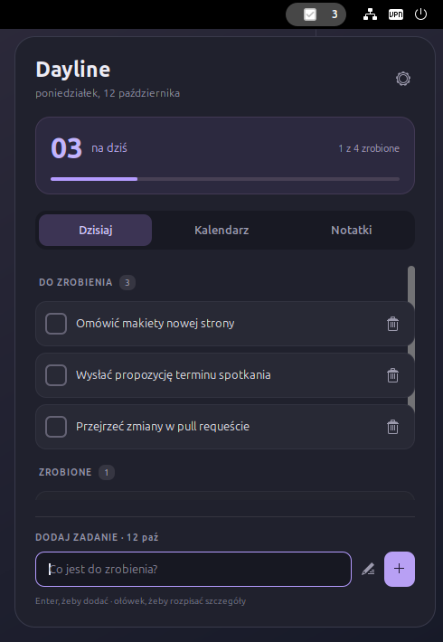
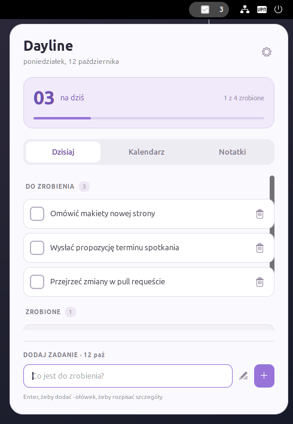
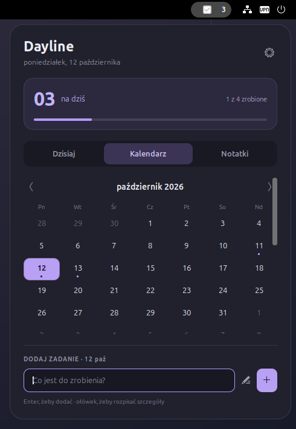
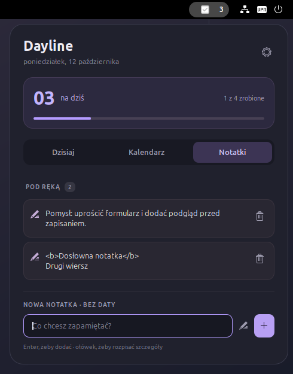

# Dayline

**Your day, a little clearer.** A small, local-first to-do list for the GNOME top bar.

See how many tasks are left **today** without opening an app. Click to plan a day, check something off, or catch a thought before it disappears.

<p align="center">
  
  
</p>

## What it does

- **Today counter** — unfinished tasks dated today, using your local timezone.
- **Dzisiaj** — today's plan, completed tasks, daily progress, and a separate overdue section.
- **Kalendarz** — a Monday-first month grid; choose any day and add tasks there. Dots indicate days with unfinished tasks.
- **Notatki** — undated notes for ideas, reminders, and details to add to a project.
- **Edit and reschedule** — click a task or note; the editor supports multiple lines and a date picker.
- **Delete with undo** — restore the last deleted entry while the extension remains enabled.
- **Light, dark, or system appearance**, with a soft violet accent.
- **Offline storage**, atomic saves, previous-version backup, and explicit JSON import/export.

No account, server, network requests, tracking, or runtime npm dependencies. The interface is currently in **Polish**. GNOME **50** is the supported and tested version; other Shell versions are not declared compatible.

## Install

```bash
git clone https://github.com/MarekBartczak/dayline.git
cd dayline
bash scripts/install.sh
```

The installer copies Dayline into your user's GNOME extension directory and tries to enable it. **On Wayland, a first installation may require logging out and back in**; the installer schedules Dayline to enable on that login. To enable it manually:

```bash
gnome-extensions enable dayline@marekbartczak.github.io
```

Alternatively, build a distributable archive and install it with GNOME's tool:

```bash
bash scripts/package.sh
gnome-extensions install --force dist/dayline@marekbartczak.github.io.shell-extension.zip
```

A code update also needs a new GNOME session on Wayland, because Shell caches loaded JavaScript modules. No administrator privileges are needed. Dependencies: GNOME Shell 50, GJS, GTK4/libadwaita for preferences, and `glib-compile-schemas` (normally supplied by GNOME).

## Using Dayline

1. Click the checkmark and count in the top bar.
2. Type in the bottom field and press **Enter**, or click **+**.
3. Switch to **Kalendarz** to add a task for a different date.
4. Switch to **Notatki** for entries without dates.
5. Click an entry to edit it. The pencil beside the input opens a larger editor for a new entry. **Ctrl + Enter** saves; **Esc** leaves the editor.
6. Open the gear menu for appearance settings and backups.

The counter excludes completed, future, and overdue tasks. Overdue tasks retain their original dates until you complete or reschedule them. Changes are saved as soon as you add, save, complete, delete, or undo an entry. Editor text is saved only when you press Save.

<p align="center">
  
  
</p>

## Your data

Default location: `~/.local/share/dayline/data.json`, or `$XDG_DATA_HOME/dayline/data.json`. This directory is **outside the source repository**. Reinstalling or disabling the extension preserves your entries.

Each save keeps the previous valid document in `data.json.bak`. Import validates the whole backup and asks before replacing your list. If a file cannot be read, Dayline preserves it and blocks edits; restore a valid JSON backup through preferences. A corrupt original is retained as `data.json.corrupt` during recovery.

Backups use a versioned JSON document containing `tasks` and `notes`. Limits: 10,000 entries, 2,000 characters per task, 10,000 per note, and 32 MiB serialized UTF-8. Oversized writes are rejected before the current file or its backup is changed. Dayline is intended for one local desktop; it does not implement cross-device synchronization.

## Development

```bash
bash scripts/check.sh       # Node domain tests, GJS storage tests, syntax/schema checks
bash scripts/test-shell.sh  # Actual isolated GNOME Shell 50 UI/lifecycle test
```

The first command needs Node.js 22+ and GJS. The Shell test also needs `gnome-shell-test-tool` from GNOME 50. It uses temporary XDG data, settings, and runtime directories, and synthetic examples. It does not touch your Dayline list or desktop extension settings.

```bash
DAYLINE_SCREENSHOTS="$PWD/docs/screenshots" bash scripts/test-shell.sh
```

`model.js` is portable domain logic; `store.js` owns GIO storage; `ui/` contains native Shell widgets; `extension.js` owns lifecycle; `prefs.js` is the GTK4/libadwaita preferences window. See `docs/superpowers/` for the approved design and implementation plan.

## Uninstall

```bash
gnome-extensions disable dayline@marekbartczak.github.io
gnome-extensions uninstall dayline@marekbartczak.github.io
```

Your tasks and notes remain in the data directory. Remove that directory yourself only if you want to erase them.

MIT licensed. Made by [Marek Bartczak](https://github.com/MarekBartczak).
